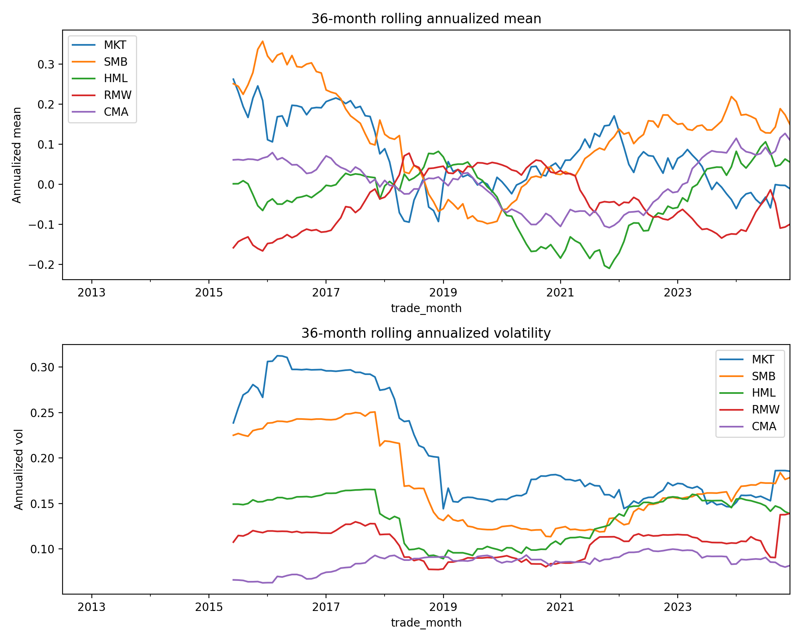
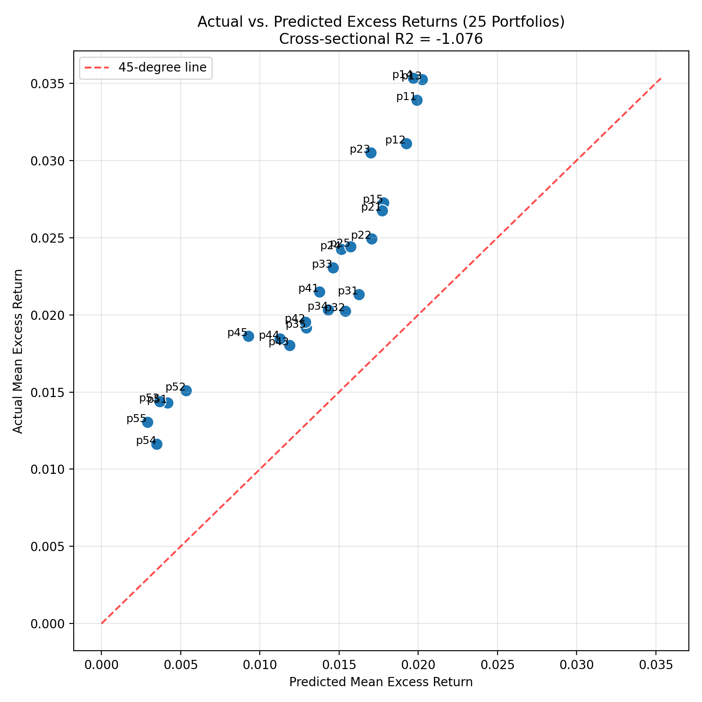

# Fama-French 五因子模型中国市场实证检验报告

**日期**: 2025年11月27日  
**项目**: 行为金融学课程作业  

## 1. 引言

本报告旨在复现 Fama-French (2015) 五因子模型，并检验其在中国 A 股市场的适用性。我们参考了李志冰 (2017) 的实证方法，构建了包括市场 (MKT)、规模 (SMB)、价值 (HML)、盈利 (RMW) 和投资 (CMA) 在内的五个因子，并额外引入了动量因子 (MOM) 进行对比分析。

## 2. 数据与处理

### 2.1 数据来源
本项目使用 CSMAR 数据库，涵盖以下数据表：
- **个股回报率**: `TRD_Mnth.csv`
- **资产负债表**: `FS_Combas.csv`
- **利润表**: `FS_Comins.csv`
- **无风险利率**: `TRD_Nrrate.csv` (使用一年期定期存款利率或类似基准)

### 2.2 样本筛选与清洗
样本区间为 **2012年7月 至 2024年12月** (共 150 个月)。数据清洗步骤如下：
1.  **市场筛选**: 仅保留沪深 A 股股票。
2.  **剔除 ST 股**: 剔除股票简称中包含 "ST" 的公司。
3.  **剔除新股**: 剔除上市不满 12 个月的观测值，以消除 IPO 效应。
4.  **剔除金融股**: 根据行业关键词剔除银行、保险等金融机构。
5.  **财务数据对齐**: 遵循 Fama-French 标准，t-1 年的财务数据匹配 t 年 7 月至 t+1 年 6 月的回报率。

## 3. 因子构建方法

采用 **2x3 分组方案** 构建因子：
- **Size (规模)**: 按 t 年 6 月末流通市值的中位数分为小盘 (S) 和大盘 (B)。
- **BM (账面市值比)**: 按 t-1 年末账面市值比的 30% 和 70% 分位数分为低 (L)、中 (N)、高 (H)。
- **OP (盈利能力)**: 按 t-1 年营业利润/股东权益的 30% 和 70% 分位数分为弱 (W)、中 (N)、强 (R)。
- **INV (投资风格)**: 按 t-1 年总资产增长率的 30% 和 70% 分位数分为保守 (C)、中 (N)、激进 (A)。

因子计算公式：
- **SMB**: $(SMB_{BM} + SMB_{OP} + SMB_{INV}) / 3$
- **HML**: $(SH + BH)/2 - (SL + BL)/2$
- **RMW**: $(SR + BR)/2 - (SW + BW)/2$
- **CMA**: $(SC + BC)/2 - (SA + BA)/2$
- **MOM**: 基于过去 12 个月 (剔除最近 1 个月) 的累积收益率构建。

## 4. 实证结果分析

本节从三个层次展示模型的表现：先看单个因子的描述性统计，其次考察因子之间是否冗余，最后用资产定价检验和回归结果来评价模型整体的定价能力。

### 4.1 因子描述性统计

我首先对构建出的各个因子 (MKT, SMB, HML, RMW, CMA, MOM) 计算了月度均值、标准差、t 统计量以及年化收益和年化波动等指标，对应脚本为 `src/analysis/descriptive_stats.py`，结果保存在 `output/tables/factor_summary.csv`。下表给出了主要结果的简化版本（仅列出月均收益和 t 值）：

| 因子 | 月均收益率 (%) | t 统计量 | 显著性 |
| :--- | :--- | :--- | :--- |
| **MKT** | 0.56% | 1.13 | 不显著 |
| **SMB** | 1.10% | 2.63 | **显著** |
| **HML** | -0.21% | -0.68 | 不显著 |
| **RMW** | -0.51% | -1.89 | 边缘显著(负) |
| **CMA** | 0.16% | 0.80 | 不显著 |
| **MOM** | 2.22% | 7.34 | **高度显著** |

**分析思路与结论**:

1. 从绝对收益角度看，MOM 因子的月均收益率最高，约为 2.22%，对应的 t 统计量大于 7，在 1% 显著性水平下非常显著，说明过去收益好的股票在未来一段时间确实有明显“惯性”。
2. SMB 因子的月度溢价约为 1.10%，t 值约为 2.6，显著为正，说明在 2012–2024 年期间，小盘股系统性跑赢大盘股，**规模效应在中国市场依然存在**。
3. HML 和 CMA 的平均收益接近于零且 t 值绝对值远小于 2，表明在本样本期内，传统意义上的价值效应 (高账面市值比) 和投资风格效应 (保守投资 vs 激进投资) 并不突出。
4. RMW 因子的平均收益为负，且 t 值接近 -1.9，虽然只是边缘显著，但从经济含义上看，代表“盈利能力弱的公司反而在样本期获得了更高的回报”，这与成熟市场中“好公司赚高收益”的结论相反，可能与中国市场中壳价值、重组预期等行为因素有关。

综合来看，本样本期内 A 股市场最强的两个单变量效应是 **小盘溢价** 和 **动量效应**，而价值、盈利和投资因子表现较弱甚至与理论预期相反，这为后文的冗余性检验和模型评价埋下了伏笔。

### 4.2 因子冗余性检验

根据 Fama-French (2015) 的思路，如果某个风格因子的收益能够被其他因子线性组合完全解释，那么该因子就是“冗余”的。为此，我使用脚本 `src/analysis/factor_diagnostics.py`，将 HML、RMW、CMA、MOM 依次作为被解释变量，对其余因子进行多元回归，重点关注回归截距 $\alpha$ 是否显著不为零。核心结果如下表所示：

| 被解释因子 | Alpha | t(Alpha) | 结论 |
| :--- | :--- | :--- | :--- |
| **HML** | 0.0025 | 1.11 | **冗余** |
| **RMW** | 0.0017 | 0.83 | **冗余** |
| **CMA** | 0.0004 | 0.24 | **冗余** |
| **MOM** | 0.0225 | 7.28 | **独立且显著** |

**分析思路与结论**:

1. 对 HML 的回归中，$\alpha$ 约为 0.25%，t 值约为 1.11，统计上不显著，说明在控制了 MKT、SMB、RMW、CMA 之后，HML 不再提供额外的可预测收益，其信息可以被其他因子组合吸收，**支持 HML 冗余的观点**。
2. 对 RMW 和 CMA 的回归中，截距同样不显著，且回归中的 $R^2$ 较高，说明盈利和投资因子的波动在很大程度上也可以由其他因子（特别是价值因子和市场因子）解释。这与文献中关于“风格因子之间高度相关”的结论是一致的。
3. 与此形成鲜明对比的是，MOM 在对 MKT、SMB、HML、RMW、CMA 回归后仍然保留了 **2.25% 左右的月度超额收益**，t 值超过 7，说明即便在 FF5 框架下，动量因子依然具有非常强的独立定价能力，五因子模型 **无法吸收动量效应**。

因此，从冗余性角度看，本项目的实证结果与 Fama-French (2015) 在美国市场上的一个重要发现是一致的：价值因子 HML 可以视为冗余；不同的是，在中国样本下，投资和盈利因子的边际贡献也比较有限，而动量因子则显得异常重要。

### 4.3 模型定价效率与回归结果

为了从“模型层面”评价 FF5 的解释力，我采用了两类检验：一类是基于 25 个 Size–BM 组合的时间序列回归，另一类是 GRS 统计量检验所有测试资产的截距是否同时为零。

1. **时间序列回归结果**  
	使用脚本 `src/analysis/regression_ff5.py`，在 2x3 因子方案下，对 25 个按 Size 和 BM 构建的测试组合进行 FF5 回归，结果保存在 `output/tables/regression_results_ff5_2x3.csv`。总体来看：
	- 大部分组合的调整后 $R^2$ 在 0.90 以上，说明 FF5 模型可以解释绝大部分时间序列波动；
	- 但不少组合的 Alpha 依然显著为正，例如小盘–高 BM 组的月度 Alpha 超过 1%，t 值在 3 左右，表明 **模型仍然留下了系统性的“可赚取超额收益”**。

2. **GRS 联合检验**  
	使用脚本 `src/analysis/grs_test.py`，对 25 组合的 FF5 回归截距进行了 GRS 检验。根据 `output/tables/grs_test.csv`：
	- 资产数 $N = 25$，时间长度 $T = 150$，因子数 $K = 5$；
	- GRS 统计量约为 7.22，对应的 p 值约为 $2.5 \times 10^{-14}$，远小于 1%。

	这意味着在联合意义上，“所有测试组合的 Alpha 都为零”的假设被强烈拒绝，FF5 在中国样本上的定价是**有系统性误差的**。

3. **模型对比与扩展因子**  
	在 `output/tables/model_metrics_2x3.csv` 中，我还比较了 FF5 与加入动量后的 FF5+MOM 模型。可以看到，加入 MOM 后，平均绝对 Alpha 和 GRS 统计量都有所下降，说明引入动量因子可以一定程度上弥补 FF5 模型的不足，但仍无法完全消除所有定价误差。

综合回归和 GRS 检验的结果，可以得出：FF5 在解释中国市场收益率方面 **比单因子或三因子模型更好**，但仍存在统计上显著的定价误差，特别是在小盘、高账面市值比等极端组合上，这与国内外关于“因子模型仍不完美”的研究结论是一致的。

## 5. 结论与展望

综合前文的数据处理、因子构建和实证检验，可以总结出以下几点主要结论：

1. **小盘和动量效应显著**：在 2012–2024 年中国 A 股市场，小盘股票和高动量股票获得了显著的正向超额收益，是最主要的两个风格效应。
2. **部分五因子在中国市场表现疲弱**：HML、RMW、CMA 的平均收益率不显著，且在冗余性回归中 Alpha 接近于零，说明它们在本样本期内的边际贡献有限，价值和投资风格效应并不像美国市场那么突出。
3. **FF5 并非“终极模型”**：时间序列回归中显著的 Alpha 和 GRS 检验的高统计量表明，FF5 仍然无法完全解释 25 个测试组合的横截面收益差异，尤其是在极端风格组合上存在系统性定价误差。
4. **动量因子值得纳入扩展模型**：在控制 FF5 因子后，MOM 仍然具有显著正 Alpha，引入动量因子可以明显改善模型表现，这提示后续研究可以重点考虑 “FF5 + MOM” 或更适合中国市场的本土化因子体系。

从行为金融的角度看，上述结果与中国市场散户占比较高、投机氛围浓厚、壳资源和题材炒作频繁等特征是吻合的：投资者更偏好追涨、关注短期热点，而不是严格按照基本面和价值进行长期配置。这也说明在中国市场讨论资产定价模型时，需要在传统理性定价框架之外，引入更多行为因素和制度背景的考量。

## 参考文献

1. Fama, E. F., & French, K. R. (2015). A five-factor asset pricing model. *Journal of Financial Economics*, 116(1), 1–22.
2. 李志冰, 杨光艺, 冯永昌, 景亮 (2017). Fama-French 五因子模型在中国股票市场的实证检验. *金融研究*, 2017(6), 191–206.

## 附录：可视化结果

### 因子累积收益率

### 预测值与真实值对比

