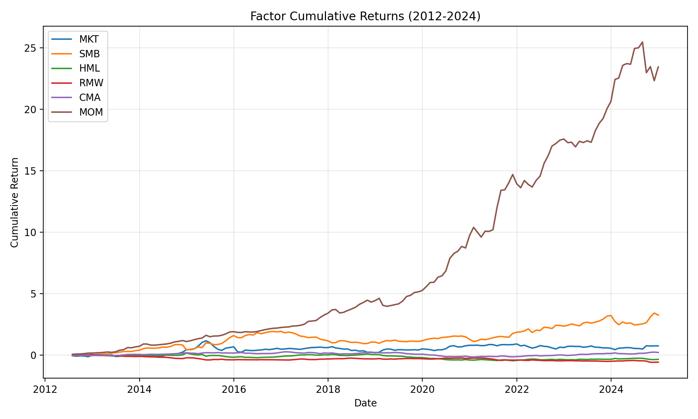

# Fama–French 五因子模型：中国 A 股实证分析

本仓库保存了 2025 年行为金融学课程作业的代码、报告和分析产物。项目参考 Fama–French（2015）及李志冰等（2017）的研究方法，使用 CSMAR 数据构建市场、规模、价值、盈利和投资因子，并比较加入动量因子、正交化投资因子后的回归结果。

原始资料覆盖 **2010 年 1 月至 2024 年 12 月**；现有报告与主要因子结果采用 **2012 年 7 月至 2024 年 12 月，共 150 个月**的样本。研究内容是因子构建与样本内资产定价检验。

## 阅读入口

| 内容 | 入口 |
| --- | --- |
| 研究方法、结果讨论和参考文献 | [实证检验报告](Fama-French五因子模型/project/REPORT.md) |
| 当前实现与参考文献的差异、样本限制 | [文献对齐说明](Fama-French五因子模型/project/docs/reference_alignment.md) |
| 数据字段、单位及市场代码 | [数据说明](Fama-French五因子模型/project/data/raw/数据说明.txt) |
| 因子构建、回归和图表源码 | [src](Fama-French五因子模型/project/src/) |
| 已保存的数值结果 | [output/tables](Fama-French五因子模型/project/output/tables/) |
| 已保存的可视化结果 | [output/figures](Fama-French五因子模型/project/output/figures/) |

## 方法与实现

处理流程为：财务报表与月度收益清洗 → 计算 Size、BM、OP、INV → 分组并计算市值加权组合收益 → 构建因子 → 对测试组合回归 → 诊断与可视化。

- **财务数据对齐**：采用合并报表，使用上一年年末财务指标，结合当年 6 月市值形成分组，匹配当年 7 月至次年 6 月的收益。
- **因子构建**：实现 `2x3`、`2x2`、`2x2x2x2` 三种分组方案，生成 MKT、SMB、HML、RMW、CMA；另外实现 MOM 和 CMAO（CMA 对其他四因子回归后的残差）。
- **测试资产**：按 Size 与 BM 的五分位构建 25 个测试组合。
- **模型检验**：回归脚本支持 CAPM、FF3、Carhart、FF5、FF5+MOM、FF5+CMAO、FF5+CMAO+MOM；分析脚本提供描述统计、风格与冗余检验、GRS 联合检验及 Alpha 图表。

实现口径需要结合代码理解：市场代码允许 `1/4/16/32/64`，综合市场收益使用 `69`，包括北证 A 股；ST 和金融股分别按股票简称识别，上市时间以数据中的首次出现月份近似。上述处理与严格使用历史 ST 状态、行业分类和真实上市日期的筛选存在差异。

## 已有结果与图表

以下是仓库已保存的输出，本次 README 整理未重新运行研究管线：

- [因子描述统计](Fama-French五因子模型/project/output/tables/factor_summary.csv)：SMB 月均收益约 `1.10%`、t 值约 `2.63`；MOM 月均收益约 `2.22%`、t 值约 `7.34`。其他因子的完整数值见原表。
- [FF5 的 25 组合回归](Fama-French五因子模型/project/output/tables/regression_results_ff5_2x3.csv)：保存各组合的 Alpha、Alpha t 值、调整后 R² 和因子系数。
- [GRS 联合检验](Fama-French五因子模型/project/output/tables/grs_test.csv)：已保存 `N=25`、`T=150`、`K=5`、统计量约 `7.217`、p 值约 `2.50e-14`。
- [模型比较表](Fama-French五因子模型/project/output/tables/model_metrics_2x3.csv)：保存 FF5 及其 MOM/CMAO 扩展的 Alpha 指标。该表的 `grs_stat` 是 `model_metrics.py` 使用对角近似计算的指标，与 `grs_test.py` 的联合检验口径不同，不能直接混用。

这些结果来自当前数据与实现，报告中的解释尚未在本次整理中独立验证。现有数据无法覆盖参考文献中的 2007 年前后子样本，详见文献对齐说明。



其他图表：[因子相关性](Fama-French五因子模型/project/output/figures/factor_correlation.png)、[Alpha 热力图](Fama-French五因子模型/project/output/figures/alpha_heatmap.png)、[预测值与实际值](Fama-French五因子模型/project/output/figures/predicted_vs_actual.png)。[Alpha 三维图](Fama-French五因子模型/project/output/figures/alpha_surface.html)需下载后用浏览器打开。

## 目录结构

```text
Fama-French五因子模型/
├── project/
│   ├── REPORT.md                 # 分析报告
│   ├── requirements.txt          # Python 依赖
│   ├── src/
│   │   ├── data_prep/            # 财务、收益及利率清洗
│   │   ├── factors/              # 指标、分组、组合和因子
│   │   ├── tests_assets/         # 构建 25 个测试组合
│   │   ├── analysis/             # 回归、诊断和绘图
│   │   ├── utils/                # 数据读写、日志和加载
│   │   └── paths.py              # 路径及市场参数
│   ├── data/raw/                 # 原始 CSV 与字段说明
│   ├── data/processed/           # 已保存的 Parquet 中间数据
│   ├── output/tables/            # 已保存的 CSV 结果
│   ├── output/figures/           # PNG 与 HTML 图表
│   └── docs/                     # 计划、进度和文献对齐记录
└── 行为金融学2025_作业资料/       # 课程说明、原始压缩包与参考文献
```

`docs/PLAN.md`、`docs/STRUCTURE.md` 保留了早期规划，部分文件名称已与当前实现不同；运行时以 `src/` 中实际存在的模块为准。

## 复现说明

### 环境与数据前提

使用能够安装 [requirements.txt](Fama-French五因子模型/project/requirements.txt) 中依赖的 Python 环境。项目使用 pandas、NumPy、PyArrow、statsmodels、Matplotlib、Seaborn、scikit-learn 和 Plotly；GRS 脚本还直接使用 SciPy。仓库未锁定完整依赖版本。

完整重建需要 `project/data/raw/` 中的以下 CSV，字段和单位应符合数据说明：

| 文件 | 内容 |
| --- | --- |
| `FS_Combas.csv` | 资产负债表（包含股票简称、报表类型、资产、负债、权益） |
| `FS_Comins.csv` | 利润表（包含营业利润） |
| `TRD_Mnth.csv` | 月个股回报率及流通市值 |
| `TRD_Cnmont.csv` | 综合月市场回报率 |
| `TRD_Nrrate.csv` | 无风险利率 |

下面的命令从仓库根目录开始，在 **PowerShell** 中执行。它们按当前源码入口整理，未在本次文档更新中完成端到端验证。重跑会写入 `data/processed/` 和 `output/`，覆盖对应的已有产物。

```powershell
cd "Fama-French五因子模型/project"
python -m venv .venv
.\.venv\Scripts\Activate.ps1
python -m pip install -r requirements.txt
$env:PYTHONPATH = (Join-Path (Get-Location) "src")
```

### 重建 2×3 因子与测试组合

先清洗财务报表，再清洗收益，保证 ST 识别所需的财务面板已经生成：

```powershell
python -m data_prep.clean_financials
python -m data_prep.clean_returns
python -m factors.compute_indicators
python -m factors.assign_groups --scheme 2x3
python -m factors.compute_portfolios --scheme 2x3
python -m factors.compute_factors --scheme 2x3
python -m factors.compute_momentum
python -m tests_assets.build_25portfolios
```

`compute_factors --scheme 2x3` 同时生成带方案名称的文件与兼容文件 `factors_monthly.parquet`。仓库已有 `factors_monthly_2x3.parquet`，但没有提交该兼容文件；描述统计、GRS 及部分绘图脚本依赖兼容文件，运行这些脚本前需要先执行上述因子生成步骤。

### 回归、检验与绘图

```powershell
python -m analysis.regression_ff5 --model ff5 --scheme 2x3
python -m analysis.regression_ff5 --model ff5_mom --scheme 2x3
python -m analysis.factor_diagnostics --scheme 2x3
python -m analysis.model_metrics --scheme 2x3 --models ff5 ff5_mom --sample-length 150
python -m analysis.grs_test
python -m analysis.descriptive_stats
python -m analysis.alpha_heatmap
python -m analysis.alpha_surface
python -m analysis.plot_predicted_vs_actual
```

其他分组方案可将分组、组合、因子和回归命令中的 `--scheme` 改为 `2x2` 或 `2x2x2x2`。回归与诊断脚本支持 `--start YYYY-MM`、`--end YYYY-MM`；模型指标脚本的 `--sample-length` 应与实际回归月份数一致。参数详情可通过对应模块的 `--help` 查看。

## 数据与使用范围

课程资料注明数据来源为 CSMAR，原始压缩包文件名带有“仅供南京大学使用”。复现前应自行确认所使用数据的访问与使用权限，仓库公开不代表第三方数据已获公开再分发授权。仓库当前也没有提供 LICENSE 文件。

参考资料及其书目信息见 [REPORT.md](Fama-French五因子模型/project/REPORT.md) 和 [课程参考资料目录](Fama-French五因子模型/行为金融学2025_作业资料/reference/)。
